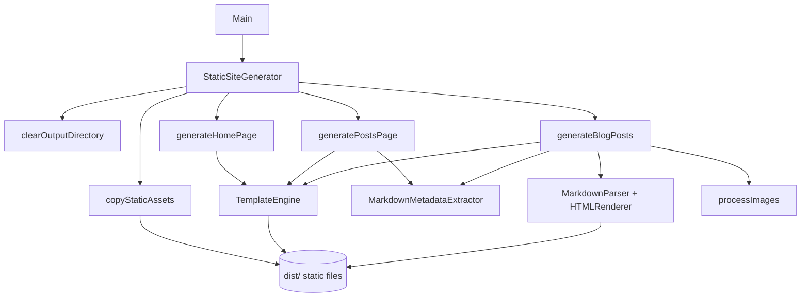
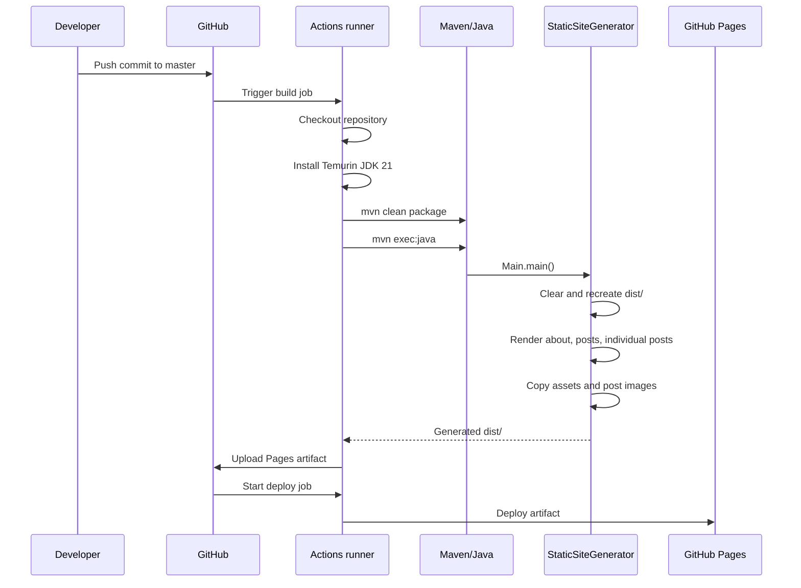

# Project Documentation: `mrudulpatil18.github.io`

## Table of Contents

- [Project Overview](#project-overview)
- [Features and Functionality](#features-and-functionality)
- [Technology Stack](#technology-stack)
- [System Architecture](#system-architecture)
- [Codebase Structure](#codebase-structure)
- [Technical Implementation](#technical-implementation)
- [Data and API Design](#data-and-api-design)
- [End-to-End Workflows](#end-to-end-workflows)
- [Security, Performance, and Reliability](#security-performance-and-reliability)
- [Testing and Deployment](#testing-and-deployment)
- [Engineering Decisions and Challenges](#engineering-decisions-and-challenges)
- [Limitations and Future Improvements](#limitations-and-future-improvements)
- [Resume and Interview Preparation](#resume-and-interview-preparation)

## Project Overview

`mrudulpatil18.github.io` is a personal static blog and portfolio site generated from Java source code and published through GitHub Pages. The repository combines:

1. A small Java static-site generator (SSG).
2. A bundled `ssmp-1.0.1.jar` dependency used to convert a constrained Markdown dialect into HTML.
3. HTML content, templates, CSS, fonts, icons, and post images.
4. A GitHub Actions workflow that builds the site, generates `dist/`, uploads it as a Pages artifact, and deploys it.

The site’s current content presents an “About Me” page and a posts index containing one long technical post, **“Building a Multiplayer Maze Game.”** That post discusses a separate MoonRift project involving maze generation, WebSockets, Canvas/isometric rendering, and game design. Those systems are described as article content here; their implementation is not present in this repository.

### Problem statement

The repository solves a narrow publishing problem: turn version-controlled content and static assets into a navigable, styled website without committing generated output. The generator provides repeatable page construction, post discovery, metadata extraction, Markdown conversion, asset copying, and GitHub Pages deployment.

### Product vision and target users

The content identifies the site as a personal knowledge and ideas space for a software engineer. Likely audiences supported by the repository are:

- Readers browsing technical writing and project retrospectives.
- Recruiters or collaborators reviewing engineering interests.
- The site owner, who can add Markdown posts and static assets to the repository.

The implementation does not include user accounts, comments, search, an editorial CMS, analytics, or server-side application behavior.

### Core value proposition

- Content remains simple, reviewable files in Git.
- The build is dependency-light: the SSG uses Java standard APIs and one bundled parser JAR.
- Pages share a single HTML template.
- Markdown posts become HTML during CI rather than requiring hand-authored generated pages.
- GitHub Actions provides a reproducible build-and-deploy path to GitHub Pages.

### Implementation status

| Area | Status | Evidence |
|---|---|---|
| Static-site generator | Implemented | `src/main/java/com/ssg/StaticSiteGenerator.java` |
| Markdown metadata extraction | Implemented | `MarkdownMetadataExtractor` |
| Markdown-to-HTML conversion | Implemented through bundled JAR | `lib/ssmp-1.0.1.jar` and `MarkdownParser` usage |
| Templates and content | Implemented | `src/main/resources/templates` and `content` |
| Static assets | Implemented | `src/main/resources/static` |
| CI/CD | Implemented | `.github/workflows/deploy.yml` |
| Automated application tests | Not present | No `src/test` tree |
| Runtime web server/API | Not present | Output is static HTML/assets |
| Separate MoonRift game implementation | Not present | Mentioned by the post and linked externally |

## Features and Functionality

### Home/about page generation

`StaticSiteGenerator.generateHomePage()`:

1. Sets `activeHome` to `active` and `activePosts` to an empty string.
2. Loads `/content/about.html`.
3. Inserts it into `/templates/base.html` as `{{content}}`.
4. Writes the result to `dist/about.html`.

The source content introduces the author, interests, and purpose of the site. The template adds shared navigation, social links, footer text, CSS, icons, and PrismJS scripts.

### Posts index generation

`generatePostsPage()`:

1. Marks the Posts navigation link active.
2. Loads `/content/posts.html`.
3. Calls `generateBlogList()`.
4. Replaces `{{content}}` and `{{blog_list}}`.
5. Writes `dist/posts.html`.

`generateBlogList()` discovers `.md` files directly under `/content/posts`, sorts them by the extracted `date` string in descending lexicographic order, and emits one preview article per post. Each preview uses:

- `title` metadata, falling back to the filename without `.md`.
- `date` metadata, falling back to `Unknown date`.
- A URL based on the post filename without its extension.

The current generated list contains `Building a Multiplayer Maze Game` dated `2025-05-14`.

### Individual blog post generation

`generateBlogPosts()`:

1. Resolves `/content/posts` from the classpath.
2. Finds direct child files ending in `.md`.
3. Reads each file as a string.
4. Extracts and strips front matter.
5. Converts the remaining Markdown with the bundled SSMP parser.
6. Inserts the generated HTML into `base.html`.
7. Rewrites `static` references to `../../static` for nested post pages.
8. Writes `dist/posts/<post-name>/index.html`.
9. Copies matching post images into `dist/posts/<post-name>/`.

The current post uses front matter:

```text
title: Building a Multiplayer Maze Game
date: 2025-05-14
```

### Front matter extraction

`MarkdownMetadataExtractor` recognizes a document beginning with a delimiter block:

```text
---
key: value
---
```

`extractMetadata()` returns a `Map<String, String>` by splitting each metadata line at its first colon. `stripMetadata()` removes the leading block and strips leading whitespace from the body.

The implementation supports simple scalar values only. It does not parse YAML types, quoted values, nested fields, multiline values, duplicate-key diagnostics, or malformed-front-matter errors.

### Markdown subset conversion

The SSG uses:

```java
MarkdownParser blockParser = MarkdownParser.fromString(strippedMarkdown);
blockParser.generateParseTree();
HTMLRenderer htmlRenderer = new HTMLRenderer(blockParser.getBlockTrees());
String htmlBody = htmlRenderer.renderHtml();
```

The bundled parser supports the subset implemented by SSMP, including headings, paragraphs, fenced code blocks, block quotes, images, unordered lists, bold, italic, inline code, links, and sidenotes. The generated article demonstrates these constructs.

### Static asset copying

`copyStaticAssets()` copies the complete `/static` resource directory to `dist/static`. Assets include:

- Tufte CSS and project overrides.
- Prism CSS.
- ET Book font files in multiple formats and styles.
- Favicons and web-manifest assets.
- Social SVG icons.
- Profile and title images.

`processImages()` copies each post’s matching image directory from `/content/posts/images/<post-name>` to `dist/posts/<post-name>`.

### Template replacement

`TemplateEngine.render()` performs direct string replacement for every map entry:

```java
result = result.replace("{{" + entry.getKey() + "}}", entry.getValue());
```

This is intentionally small and has no escaping, conditional syntax, loops, or template validation.

### Styling and presentation

`static/tufte.css` supplies the main typography/layout foundation. `static/override.css` customizes:

- Active navigation markers.
- Accent-color selection.
- Header/footer layout.
- Responsive header behavior.
- Heading decorations and hover styling.
- Social icon sizing.
- Blog preview metadata.
- Figure image rounding.

The template loads PrismJS from `unpkg.com` for code highlighting. Prism’s autoloader is referenced but no local JavaScript bundle is stored.

## Technology Stack

| Technology | Role |
|---|---|
| Java 21 | SSG source/target release configured in `pom.xml` and CI |
| Maven | Build and execution orchestration |
| Maven Compiler Plugin 3.10.1 | Compiles with `<release>21</release>` |
| Exec Maven Plugin 3.1.0 | Runs `com.ssg.Main` during CI |
| Java standard library | Filesystem, classpath resource access, regex, collections, URL/URI handling |
| SSMP 1.0.1 JAR | Local Markdown-to-HTML parser dependency |
| HTML/CSS | Generated site and presentation |
| PrismJS CDN | Client-side syntax highlighting scripts |
| GitHub Actions | Build, artifact upload, and deployment |
| GitHub Pages | Static hosting target |

### Maven dependency model

`pom.xml` declares:

- Group: `com.ssg`
- Artifact: `ssg`
- Version: `1.0-SNAPSHOT`
- System-scoped dependency: `lib/ssmp-1.0.1.jar`

The system-scoped dependency is resolved from a repository-relative path rather than a Maven repository. This makes the build self-contained when the JAR is present, but couples the project to that exact file location and artifact version.

## System Architecture

### Build-time architecture

```mermaid
flowchart LR
    Git[Git push to master] --> Actions[GitHub Actions]
    Actions --> Checkout[actions/checkout@v4]
    Checkout --> JDK[Temurin JDK 21]
    JDK --> Maven[mvn clean package]
    Maven --> Exec[mvn exec:java]
    Exec --> Main[com.ssg.Main]
    Main --> Generator[StaticSiteGenerator]
    Generator --> Resources[Classpath resources]
    Resources --> Parser[Bundled SSMP parser]
    Generator --> Dist[dist/]
    Dist --> Artifact[actions/upload-pages-artifact@v3]
    Artifact --> Deploy[actions/deploy-pages@v4]
    Deploy --> Pages[GitHub Pages]
```

### Generator component architecture



### Runtime architecture

There is no application server in this repository. GitHub Pages serves the generated files as static resources. Browser behavior consists of HTML rendering, CSS styling, local image/font loading, and client-side PrismJS loaded from a CDN.

## Codebase Structure

```text
mrudulpatil18.github.io/
├── .github/workflows/deploy.yml
├── .gitignore
├── README.md
├── lib/
│   └── ssmp-1.0.1.jar
├── pom.xml
└── src/main/
    ├── java/com/ssg/
    │   ├── Main.java
    │   ├── MarkdownMetadataExtractor.java
    │   ├── StaticSiteGenerator.java
    │   └── TemplateEngine.java
    └── resources/
        ├── content/
        │   ├── about.html
        │   ├── posts.html
        │   ├── posts/multiplayer_game.md
        │   └── posts/images/multiplayer_game/
        ├── static/
        │   ├── tufte.css
        │   ├── override.css
        │   ├── prism.css
        │   ├── site.webmanifest
        │   ├── fonts/
        │   ├── icons/
        │   └── images/
        └── templates/base.html
```

The actual static directory uses ET Book subdirectories and flat icon/image files; the abbreviated tree above groups them by role.

### Important files and entry points

- `src/main/java/com/ssg/Main.java` — executable entry point; creates a generator targeting `dist`.
- `src/main/java/com/ssg/StaticSiteGenerator.java` — orchestration, discovery, rendering, copying, cleanup, and file writes.
- `src/main/java/com/ssg/MarkdownMetadataExtractor.java` — front matter parsing and removal.
- `src/main/java/com/ssg/TemplateEngine.java` — placeholder replacement.
- `src/main/resources/templates/base.html` — shared page shell.
- `src/main/resources/content/about.html` — home page body.
- `src/main/resources/content/posts.html` — posts page body and `{{blog_list}}` insertion point.
- `src/main/resources/content/posts/multiplayer_game.md` — current Markdown article.
- `.github/workflows/deploy.yml` — CI build and Pages deployment.
- `lib/ssmp-1.0.1.jar` — compiled parser dependency.

## Technical Implementation

### Generation lifecycle

`StaticSiteGenerator.generateSite()` always performs the following sequence:

1. `clearOutputDirectory()`
2. `Files.createDirectories(Paths.get(outputDir))`
3. `generateHomePage()`
4. `generatePostsPage()`
5. `generateBlogPosts()`
6. `copyStaticAssets()`
7. Log success

The output directory is therefore rebuilt from classpath resources on every run. `clearOutputDirectory()` recursively walks the target and deletes files before directories using reverse path ordering.

### Resource loading

Content and templates are loaded with `getResourceAsStream()` through `readResourceFile()`. Posts and images are located with `getResource()` and converted to `File`/`Path` through URI conversion. This works naturally for the current exploded classpath used by Maven execution, but resource directories inside a packaged JAR are not guaranteed to behave like ordinary filesystem directories.

### Post discovery and ordering

Both `generateBlogList()` and `generateBlogPosts()` inspect direct files under the classpath `/content/posts` directory. Nested Markdown files are not recursively discovered. The list sorts date strings using `String.compareTo`, which works for the current ISO-like `YYYY-MM-DD` value but does not parse dates or validate formats.

### Path construction

Top-level pages use `static/...` asset paths. Individual post pages are nested two levels below `dist`, so `generateBlogPosts()` performs:

```java
renderedHtml.replace("static", "../../static")
```

This is a broad text replacement, not a URL-aware transformation. It changes every occurrence of the literal string `static` in the rendered document, not only asset paths.

Post links in the index are absolute paths such as `/posts/multiplayer_game`. Individual posts are written as `posts/multiplayer_game/index.html`, which allows directory-style hosting when the static host resolves index files.

### Markdown conversion boundary

The SSG does not implement Markdown itself. It delegates parsing to SSMP:

1. Front matter is removed.
2. SSMP splits content into blocks.
3. SSMP lexes inline syntax and constructs nodes.
4. SSMP renders HTML.
5. The SSG places that HTML into the base template.

Because the bundled JAR is compiled code rather than source in this repository, the SSG’s Markdown behavior is an external binary contract. The JAR contains SSMP classes under `com/ssmp`, including `MarkdownParser`, `HTMLRenderer`, block/inline node classes, and parser support classes.

### Error handling

- `Main.main()` catches `IOException`, logs a message, and prints the stack trace.
- `processTemplate()` wraps resource failures as `IOException("Template not found: ...", cause)`.
- Missing content files produce an error message and empty content.
- Missing `/content/posts` causes individual post generation to return without output; the blog list returns a fallback paragraph.
- Image-copying errors are logged by `copyDirectoryContents()` and do not necessarily abort the entire site build.
- `generateBlogPosts()` catches broad `Exception` and logs an error, which can produce a partially generated site while allowing the process to continue.
- `copyStaticAssets()` also catches broad `Exception` and logs failures.

This favors best-effort generation over fail-fast builds, but it can hide incomplete output from CI unless the generated artifact is inspected.

### State and concurrency

All generator state is instance-local except for no shared mutable global state. The workflow invokes one generator in one process. There is no thread pool, asynchronous task, database transaction, cache, or cross-run state. The GitHub Actions workflow uses a Pages concurrency group with `cancel-in-progress: false`, so queued runs are not canceled by newer runs.

## Data and API Design

### External API surface

The repository exposes no HTTP API, JSON API, database schema, authentication flow, or server-side request handler. The deployed output is a collection of static files.

### Internal Java API

The main programmatic entry point is:

```java
new StaticSiteGenerator("dist").generateSite();
```

Supporting methods are private except for the public static metadata methods:

```java
Map<String, String> MarkdownMetadataExtractor.extractMetadata(String markdown);
String MarkdownMetadataExtractor.stripMetadata(String markdown);
```

`TemplateEngine.fromString(String)` constructs a renderer and `render(Map<String, String>)` substitutes placeholders.

### Data models

The generator’s data structures are deliberately simple:

| Data | Representation | Meaning |
|---|---|---|
| Front matter | `Map<String, String>` | Post metadata such as title/date/description |
| Template replacements | `Map<String, String>` | Values for `{{...}}` placeholders |
| Post source | `String` | Full Markdown file content |
| Generated page | `String` | Final HTML text |
| Files/assets | `Path`, `File`, `URL` | Classpath and output filesystem locations |

There is no schema enforcement. A missing title/date uses a fallback; malformed values are accepted as plain strings.

## End-to-End Workflows

### Push to deployed Pages



### Adding a blog post

1. Add a `.md` file directly under `src/main/resources/content/posts`.
2. Optionally add front matter between `---` delimiters.
3. Put matching images under `src/main/resources/content/posts/images/<filename-without-md>`.
4. Commit and push to `master`.
5. CI discovers the new file.
6. `generateBlogList()` adds a preview using metadata.
7. `generateBlogPosts()` converts the body and writes a directory-style page.
8. The matching image directory is copied into that post directory.
9. GitHub Pages publishes the generated artifact.

### Local generation

With Java 21 and Maven available:

```bash
mvn clean package
mvn exec:java
```

The generated site is written to `dist/`. The repository’s `.gitignore` excludes `dist/`, `target/`, IDE metadata, and other build output.

## Security, Performance, and Reliability

### Security

- No application authentication or authorization is implemented.
- No server-side secrets, credentials, or environment variables are required by the generator.
- Content is inserted into templates and generated HTML without a sanitization layer.
- `TemplateEngine` performs raw string replacement, so content containing template-like markers can interact with placeholders.
- The Markdown parser’s generated HTML is inserted as trusted output.
- The template allows external script loading from `unpkg.com`; availability and integrity depend on that CDN.
- The post content includes external links and the template includes public social/contact links.
- The workflow grants `contents: read`, `pages: write`, and `id-token: write`, matching the Pages deployment pattern.
- `setAllowedOrigins("*")` appears only in an illustrative WebSocket code block inside the blog post; there is no WebSocket server in this repository.

### Performance

The site is small and generation is batch-oriented. The generator reads posts and templates into memory, creates strings, and copies assets. The most significant work is asset copying, especially large images and font files; the current repository includes several large raster assets.

Potential scaling constraints:

- Every build deletes and recreates the entire output tree.
- Every post is read more than once: once for sorting/list generation and again for rendering.
- `generateBlogList()` reads all post files during sorting and then reads them again to render entries.
- `Files.walk()` copies every file in static and image trees on each run.
- No incremental build or content cache exists.

These are appropriate for the current small site but would become more material as post and asset counts grow.

### Reliability

The build is deterministic for content and template inputs except for the bundled SSMP renderer’s sidenote UUID generation. The generated HTML for posts containing `==...==` can therefore differ between runs because sidenote ids use random UUIDs.

Reliability risks include broad exception handling, best-effort asset copying, filesystem-dependent classpath directory discovery, and the absence of tests that validate generated links or HTML structure.

## Testing and Deployment

### Automated testing

No `src/test` directory, test dependencies, or test workflow step is present. The CI pipeline validates compilation and execution indirectly through:

1. `mvn clean package`
2. `mvn exec:java`
3. Pages artifact upload

There are no assertions for metadata parsing, post ordering, generated file names, asset paths, malformed input, or deployment URLs.

### Build configuration

`pom.xml` sets Java release 21, UTF-8 encoding, compiler plugin 3.10.1, and exec plugin 3.1.0. The exec plugin is configured with `com.ssg.Main` and adds the bundled SSMP JAR to the runtime classpath.

### CI/CD workflow

`.github/workflows/deploy.yml` triggers on:

- Pushes to `master`.
- Pull requests targeting `master`.

The build job runs on `ubuntu-latest`, checks out the repository, installs Temurin JDK 21, prints Java/Maven versions, packages with Maven, runs the generator, and uploads `./dist` using `actions/upload-pages-artifact@v3`.

The deploy job waits for build completion, targets the `github-pages` environment, and calls `actions/deploy-pages@v4`.

The workflow does not define application logs, monitoring, rollback logic, preview deployments, link checking, HTML validation, dependency scanning, or artifact retention policy beyond the actions’ defaults.

### Deployment output

The generator currently produces:

```text
dist/
├── about.html
├── posts.html
├── posts/multiplayer_game/index.html
├── posts/multiplayer_game/{post images}
└── static/{CSS, fonts, icons, and images}
```

## Engineering Decisions and Challenges

### A small custom SSG instead of a full framework

The project uses a few focused Java classes rather than Jekyll, Hugo, or a full CMS. This reduces conceptual and dependency overhead and makes the generation pipeline visible. The trade-off is that template syntax, metadata parsing, Markdown support, validation, and error reporting are all intentionally limited.

### Reusing SSMP through a local JAR

The site delegates Markdown parsing to the separate SSMP project and stores its compiled JAR under `lib/`. This creates a clean boundary between site generation and parsing, but a system-scoped dependency is less portable than a published Maven artifact and does not provide source-level integration in this repository.

### Resource-backed content

Keeping content under `src/main/resources` lets Maven place it on the runtime classpath and keeps source, templates, and assets versioned together. The implementation’s conversion of classpath resources to filesystem paths is simple and works in the current CI execution model, but it depends on resources being accessible as directories.

### Presentation-specific HTML

The base template and override CSS deliberately use a Tufte-inspired presentation: margin notes, semantic sections, stylized headings, ET Book fonts, and responsive navigation. This gives the site a distinctive reading experience but couples generated pages to a specific asset layout and relative-path strategy.

### Rebuilding instead of mutating output

Clearing `dist/` at the beginning of each build avoids stale pages and stale assets. The cost is that every build performs a full rewrite and a transient failure can leave an incomplete local output tree.

### Article-driven product surface

The current site’s main feature is publishing a technical narrative. The post itself documents challenges in an external multiplayer game: Hunt-and-Kill maze generation, thin-wall/thick-wall coordinate conversion, WebSocket room communication, Canvas rendering, isometric camera behavior, and asset-driven presentation. Those are documented as content and design lessons, not as code implemented here.

## Limitations and Future Improvements

### Current limitations

- No automated tests or generated-output assertions.
- Only direct child Markdown files are discovered.
- Front matter parsing is simplistic and not YAML-compliant.
- Post sorting compares raw strings rather than parsed dates.
- `description` is extracted but not emitted in the current blog preview.
- `extractTitleFromPost()` exists but is unused.
- The generated blog list closes `</ul>` even though it opens `<section>` and emits `<article>` elements; this is invalid HTML structure.
- Asset path rewriting uses global string replacement.
- Absolute navigation paths (`/about`, `/posts`) assume the site is served at the domain root.
- The site relies on a third-party PrismJS CDN at runtime.
- Broad exception catches can allow partial or misleading output.
- Resource directory handling may not work when resources are packaged inside a JAR.
- No sitemap, RSS feed, canonical metadata, Open Graph metadata, robots policy, or broken-link checking is implemented.
- The static web manifest has empty `name` and `short_name` values.
- Generated post pages inherit the base title `Mrudul | Home`.

### Future improvements

1. Add unit tests for metadata extraction, template replacement, post discovery, sorting, and path rewriting.
2. Add an integration test that generates a fixture site and validates expected files, links, and asset references.
3. Replace system-scoped JAR usage with a versioned Maven artifact or a multi-module build.
4. Parse front matter with a documented schema and validate required fields.
5. Parse dates as dates and define tie-breaking behavior.
6. Generate valid list markup and validate HTML in CI.
7. Make base URLs configurable for project-page hosting.
8. Replace global `static` replacement with URL-aware template variables.
9. Fail CI on missing required resources or failed asset copies.
10. Add page titles and metadata per post, plus canonical/Open Graph tags.
11. Add a local Prism bundle or Subresource Integrity if CDN loading is retained.
12. Add RSS/Atom generation, sitemap generation, and link checking if the blog grows.
13. Add incremental generation or content hashing for larger asset collections.
14. Add accessibility checks for navigation, images, heading order, and focus states.
15. Add dependency and workflow security scanning.

These are recommendations, not implemented functionality.

## Resume and Interview Preparation

### Resume bullet candidates

- Built a Java 21 static-site generator that converts resource-backed HTML and Markdown content into a GitHub Pages-ready `dist/` artifact.
- Integrated a locally packaged Markdown parser through Maven and composed block parsing, metadata extraction, templating, and HTML rendering into a repeatable publishing pipeline.
- Implemented front matter extraction, date-based post ordering, directory-style post generation, and post-specific image copying.
- Created a reusable HTML template system with active navigation state, shared footer/social content, responsive styling, Tufte CSS, ET Book fonts, and PrismJS integration.
- Automated GitHub Pages delivery with GitHub Actions, JDK 21 setup, Maven build/execution, Pages artifact upload, and deploy jobs.
- Designed filesystem-safe full rebuild behavior by clearing stale output before regenerating pages and static assets.
- Diagnosed trade-offs of a dependency-light custom SSG, including classpath resource handling, relative asset paths, Markdown subset limitations, and best-effort error handling.

Only claim the MoonRift multiplayer game implementation as a separate project; this repository contains the article about it, not its Java/Spring/WebSocket source.

### Key engineering contributions and technologies

- Java 21 and Maven.
- Static-site generation and build-time rendering.
- GitHub Actions and GitHub Pages.
- Classpath resource and filesystem APIs.
- Regex-based metadata extraction.
- Template substitution.
- Markdown parser integration through a local JAR.
- HTML/CSS asset organization.
- Responsive/Tufte-inspired presentation.
- CI artifact-based deployment.

### Likely technical interview questions

1. **Why build a static-site generator instead of serving content dynamically?**  
   The site is mostly immutable content, so build-time rendering reduces runtime infrastructure and lets GitHub Pages serve files directly.
2. **How does a new Markdown post become a deployed page?**  
   CI runs `Main`, which discovers the file, extracts front matter, strips it, delegates body parsing to SSMP, applies the template, copies images, and uploads `dist`.
3. **Why is the SSMP dependency system-scoped?**  
   It is a local compiled JAR under `lib`; this is simple and self-contained but less portable than repository-based dependency resolution.
4. **How does front matter parsing work?**  
   A DOTALL regex matches a leading `---` block; each line is split at the first colon into a string key/value pair.
5. **How are post previews sorted?**  
   Metadata dates are compared as descending strings. ISO-like dates sort correctly lexicographically, but arbitrary formats do not.
6. **What are the risks of classpath directory traversal?**  
   `getResource()` plus `toURI()` assumes directory-like resources; packaged archive resources may not support `File.listFiles()` directly.
7. **How are nested post asset paths handled?**  
   The generator globally replaces `static` with `../../static` in individual post HTML and copies post images beside `index.html`.
8. **What happens when a content file is missing?**  
   Content reads log an error and return empty content; post and static generation use additional best-effort fallbacks and broad catches.
9. **How would you make deployment safe for a project subpath?**  
   Introduce a configured base URL and generate all navigation/assets from it instead of hard-coded root paths and string replacement.
10. **What tests would you add first?**  
    Metadata edge cases, deterministic post ordering, a fixture generation test, output path/link assertions, missing-resource failures, and HTML validation.

### Project explanation

**30 seconds:** This is a Java 21 static-site generator for a personal GitHub Pages blog. It reads HTML content, Markdown posts, templates, and assets from resources; extracts post metadata; converts Markdown through a bundled SSMP parser; writes `dist/`; and deploys that artifact with GitHub Actions.

**2 minutes:** The repository uses a small build-time publishing architecture. `Main` creates `StaticSiteGenerator`, which clears the output directory and generates the about page, posts index, individual post directories, and static assets. `MarkdownMetadataExtractor` handles simple `---` front matter, while `TemplateEngine` performs placeholder substitution in `base.html`. Each Markdown body is passed to the bundled SSMP `MarkdownParser` and `HTMLRenderer`, then embedded into the shared template. GitHub Actions installs JDK 21, runs Maven packaging and the generator, uploads `dist` as a Pages artifact, and deploys it. The main trade-offs are simplicity and low runtime infrastructure versus limited Markdown/front-matter validation, filesystem-dependent classpath resource discovery, global relative-path rewriting, and no automated tests.
